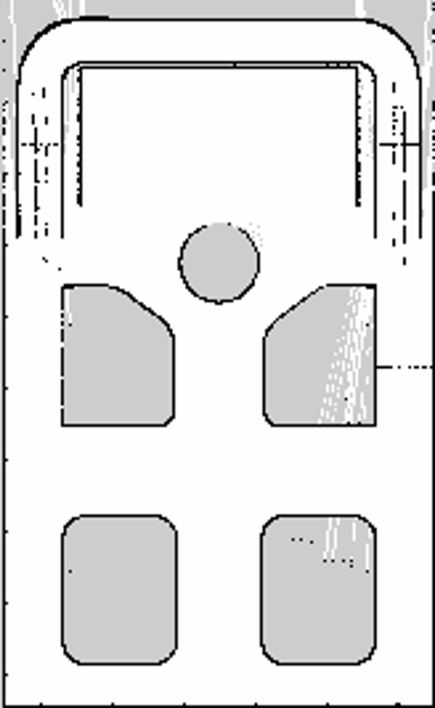
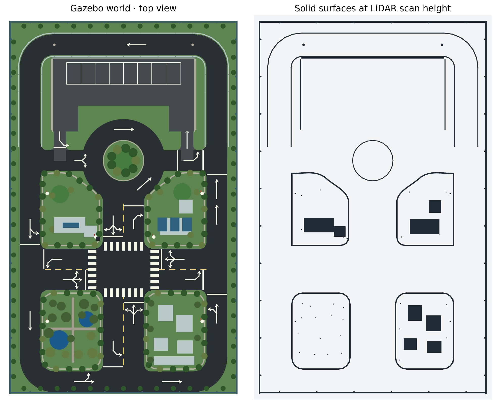

# ROS 2 沙盘自动驾驶仿真（按手绘图修订）





本仓库是可直接放入 `~/ros2_ws/src/sandbox_autodrive` 的 ROS 2 Python 包。`maps/sandbox.yaml` 和 `maps/sandbox.pgm` 是更新外观后，小车完成闭环巡航生成的 SLAM 地图；启动仿真后，实时地图仍由 `/map` 更新。地图中能辨认外环、中央圆岛、十字路口和四块绿地的边界。

本工作区的虚拟机运行 **ROS 2 Humble + Gazebo Classic 11**。场景按横向 3.3 m、纵向 5.4 m 定标。外环和中央圆岛两侧岔路各宽 0.30 m、均为单向；中央十字路口四条双向道路总宽 0.60 m。中央岛的两条岔路都从西向东行驶，不绕岛循环。上方道路高约 0.15 m，左右外环从停车场底部附近开始爬坡。

`sandbox_autodrive/build_world.py` 生成 `worlds/sandbox.world`。道路标志作为 Gazebo 路面上的白色薄层，集中在路口附近；十字口设置斑马线、停止线和驶入车道的三向箭头，T 字口的驶入车道设停止线。双向路中心为黄色虚线。停车场只有上排 8 个车位（约 0.19 m × 0.31 m），A 为左下单向出口，B 为右下单向入口。圆岛西侧分岔箭头位于停车场出口下游，不表示可以从外环驶入 A 出口。

外观按沙盘照片补充了西南角的水池、步道和树木，东南角的蓝色玻璃建筑群，北侧两块低矮展馆、屋顶太阳能板，以及绿地边缘的灌木、路灯和围栏。绿地、圆岛、停车场挡墙与高架两侧有连续的实体边缘；其高度覆盖小车二维激光雷达的扫描平面，因此 SLAM 地图能显示路面轮廓。点对点行驶时，激光安全停车只检查车身前后对应的狭窄通道；静态场景的预设建图巡航跳过该停车判断，避免在弯道反复误停。

小车长 0.22 m，最外侧车宽约 0.106 m，轴距 0.13 m。两辆车并列在 0.30 m 路面上时，中心间隔和两侧余量可各留约 0.03 m；行驶规则仍按单向。车辆使用 Gazebo Classic 的 `gazebo_ros_ackermann_drive`，`/cmd_vel.angular.z` 表示前轮转向角。默认启用 `pose_stabilizer`，按相同速度和转角更新车体位姿，防止小车在 0.15 m 高架接缝处翻落；若要只观察原生物理插件行为，可设置 `stabilize_pose:=false`。

## 构建与启动

在 Ubuntu 图形桌面终端执行：

```bash
cd ~/ros2_ws
python3 src/sandbox_autodrive/sandbox_autodrive/build_world.py
source /opt/ros/humble/setup.bash
colcon build --packages-select sandbox_autodrive --symlink-install
source install/setup.bash
ros2 launch sandbox_autodrive sandbox.launch.py gui:=true rviz:=false
```

点对点自动驾驶与自动泊车使用独立启动命令（请先关闭正在运行的旧仿真）：

```bash
source /opt/ros/humble/setup.bash
source ~/ros2_ws/install/setup.bash
ros2 launch sandbox_autodrive parking.launch.py gui:=true rviz:=true bay_index:=5
```

默认从右侧外环 `(1.35,-1.45)` 出发，绕上方高架驶到停车场 B 入口，沿过道驶入上排第 6 个车位（`bay_index` 从 0 开始），然后保持停车。可选 `bay_index:=0` 至 `bay_index:=5`；靠近 B 入口的最后两个车位需要另一套倒车入位轨迹，当前演示不选择它们。`/route` 显示当前阶段规划轨迹，`/drive_state` 显示驾驶、泊车、倒车、等灯和到达状态。此演示按已知道路几何跟踪路线，没有相机或雷达感知。

若要让车倒出车位、从 A 出口离开并按信号灯行驶到最终目标，在另一个终端执行：

```bash
source /opt/ros/humble/setup.bash
ros2 topic pub --once /parking_depart std_msgs/msg/Empty '{}'
```

启动时加 `park_seconds:=5` 可让它停车 5 秒后自动执行驶出与返程。

## SLAM 与任意可通行目标

在原有仿真关闭后，用以下命令同时启动 Gazebo、二维激光雷达、`slam_toolbox`、有向车道规划器和 RViz：

```bash
cd ~/ros2_ws
source /opt/ros/humble/setup.bash
source install/setup.bash
ros2 launch sandbox_autodrive slam_nav.launch.py gui:=true rviz:=true
```

默认先按合法路线巡航一圈建立地图，随后停下等待目标。也可以加 `auto_survey:=false` 立即等待目标；车辆行驶时地图会继续更新。在 RViz 的 **2D Goal Pose** 工具中点击任意可通行的道路或车位，节点会把目标吸附到对应车道中心线，按单向路、十字路口转向和停车场 B 进 A 出规则规划。正在行驶时点击新目标，会从当前位置重新规划；目标落在建筑、绿化区或围栏外时，`/nav_result` 会给出拒绝原因。所有 8 个车位均有驶入与倒出路线。`/drive_state` 可查看行驶、泊车、倒车、红灯等待、激光安全停车及到达状态。

也可在另一个终端按坐标发送目标（坐标单位为米）：

```bash
source /opt/ros/humble/setup.bash
source ~/ros2_ws/install/setup.bash
ros2 run sandbox_autodrive send_goal 0.3075 1.93 --frame odom
```

实时地图来自 `/scan` 与 `slam_toolbox`，发布在 `/map`，分辨率 0.02 m；RViz 显示地图、扫描、车辆和规划路线。Gazebo 在本仿真中提供稳定的世界坐标里程计；`config/slam.yaml` 关闭扫描匹配和回环修正，避免在重复的路沿几何上把地图逐渐拉斜。仓库内的地图是按此配置重新跑完整圈后保存的。若要保存当前地图：

```bash
mkdir -p ~/ros2_ws/maps
ros2 run nav2_map_server map_saver_cli -f ~/ros2_ws/maps/sandbox
```

本功能的“任意位置”指沙盘内可行驶路面和车位，不能驶入建筑或绿化区。路由使用已知的单向车道拓扑，SLAM 提供实时地图和坐标变换；前方激光近距离检测会停车，但目前不在车道内绕行动态障碍物。车体在高架上仍使用位姿稳定处理，因此这是车道规划、跟踪与二维 SLAM 的仿真演示。

若只运行后台仿真：

```bash
ros2 launch sandbox_autodrive sandbox.launch.py gui:=false rviz:=false
```

闭环示范路线从右侧外环出发，爬坡通过上方道路，左侧转入中央岛下方的西向东岔路，再转入十字路口北侧的南行车道；遇红灯在斑马线前停车，绿灯后右转驶入左侧外环，经下方道路回到起点并停车。重新启动仿真可重播一次。路线由 `config/route.json` 定义，信号灯周期为 60 秒。Gazebo 路口的三色灯头和顶部指示灯随 `/traffic_light_state` 同步变色；RViz 也有对应灯色标记。

ROS 话题：`/route`、`/odom`、`/cmd_vel`、`/traffic_light_state`、`/drive_state`、`/vehicle_marker`、`/traffic_light_marker`。RViz 显示车辆位姿和路线，Gazebo 显示三维路面和小车。

实际虚拟机没有安装 Gazebo Fortress 与 `ros_gz_bridge`，因此本版直接使用已经可用的 Classic ROS 插件接口。
